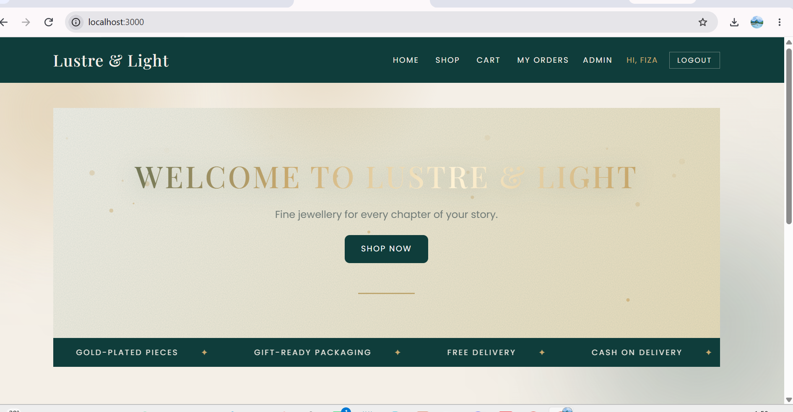
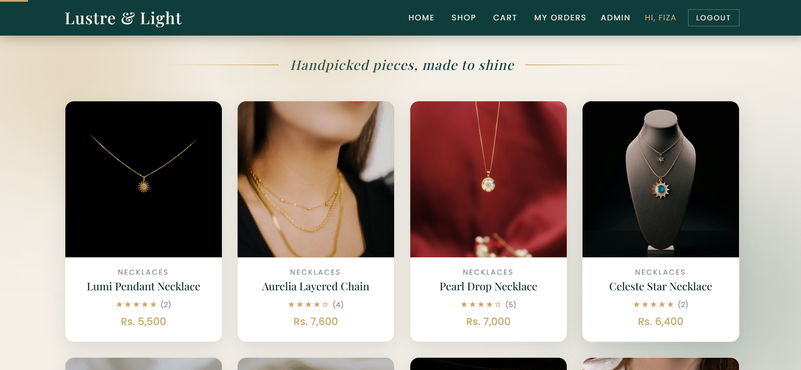
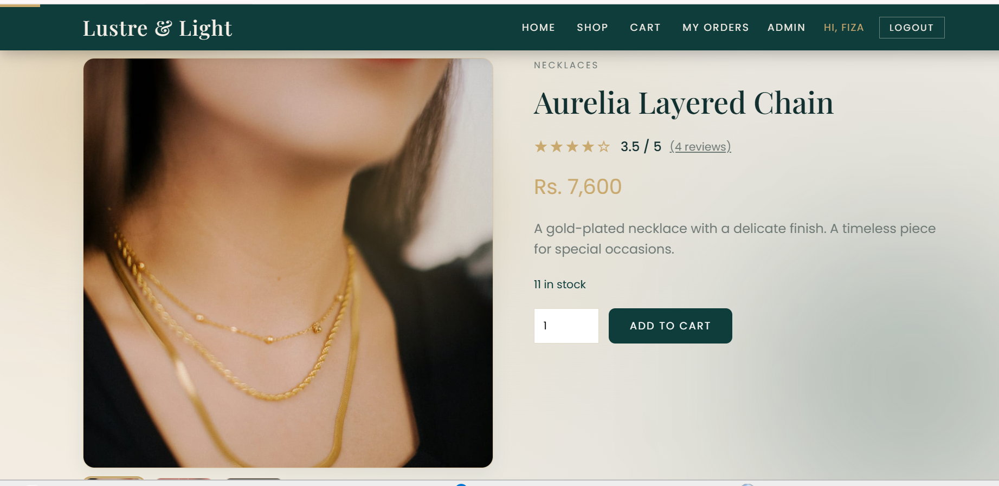
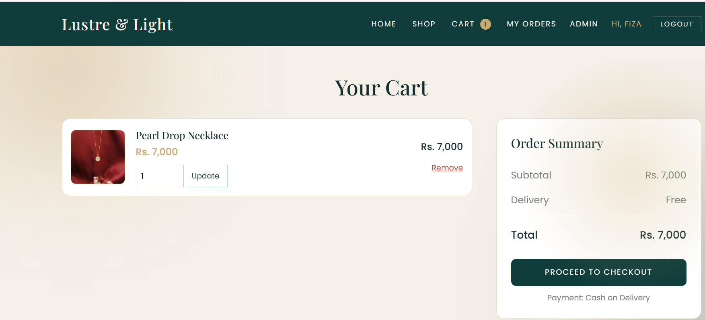
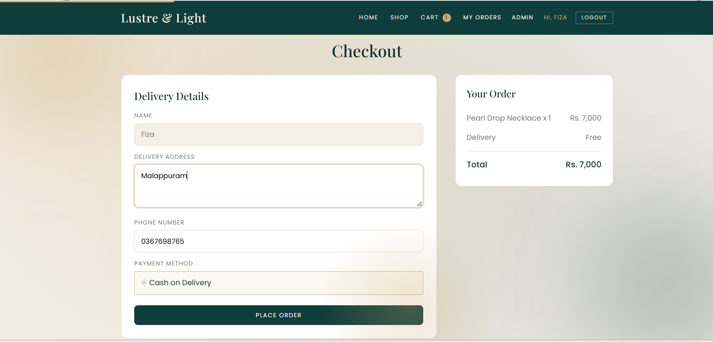
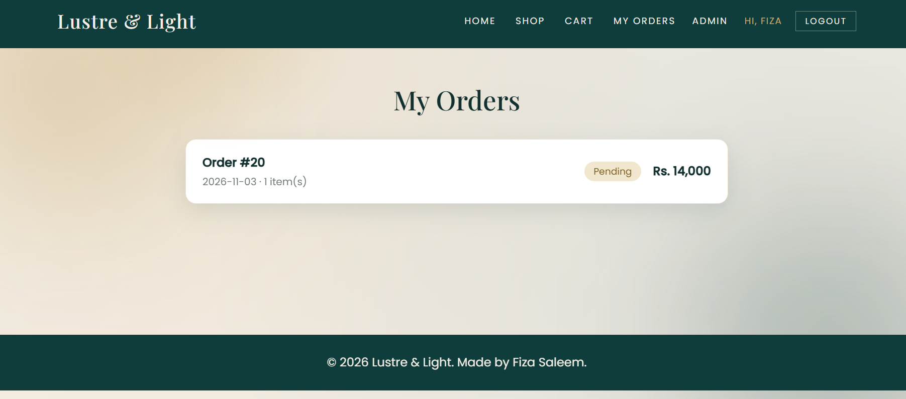
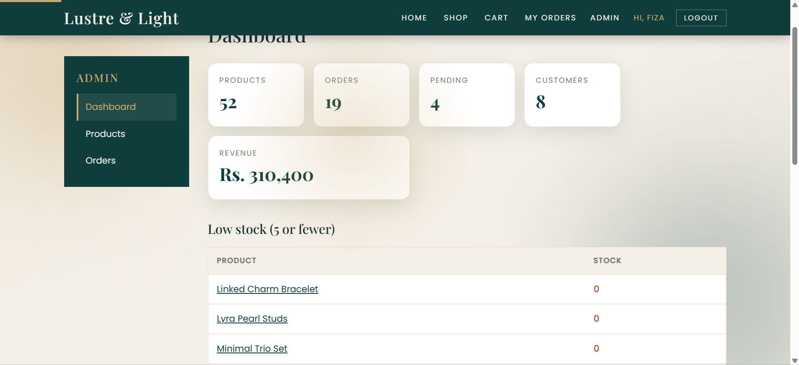
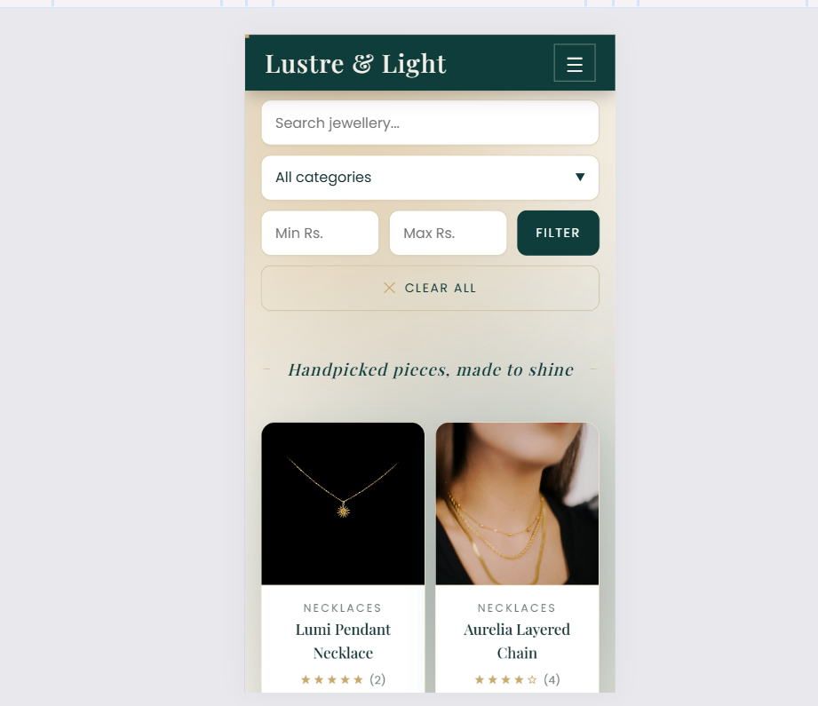

# Lustre & Light - Jewellery Store

A full-stack e-commerce web app for a jewellery brand. Customers can browse products, search and filter, add items to a cart, check out (Cash on Delivery) and track their orders. An admin dashboard manages products, stock and orders.

Built as **Project 2** of the Codneura Full Stack Developer internship.

## Features

**Customer side**
- Product catalogue with 5 categories and 52 products
- Search by name, filter by category and price range
- Product page with image gallery, star ratings, reviews and related products
- Shopping cart: add, update quantity, remove (stock limits are respected)
- Register, login and logout (passwords are hashed with bcrypt)
- Checkout with address and phone, demo payment: Cash on Delivery
- Order confirmation and order history with a status timeline (pending, confirmed, shipped, delivered)
- Responsive design with a mobile menu, animations and custom 404 / 403 / 500 pages

**Admin side**
- Dashboard: total products, orders, pending orders, customers, revenue, low-stock list, recent orders
- Add, edit, delete products (with gallery images) and update stock quickly
- View all orders, filter by status, change order status
- Cancelling an order puts the stock back
- Admin pages are protected: normal users get a 403 page

## Tech stack
- Node.js, Express
- EJS templates
- SQLite (better-sqlite3), sessions stored in SQLite (better-sqlite3-session-store)
- bcryptjs, express-session
- Plain CSS and JavaScript (no framework)

## How to run

Requires Node.js 22 or newer (needed by better-sqlite3).

    git clone <this-repository-url>
    cd E-commerce
    npm install
    node seed.js
    node app.js

Then open http://localhost:3000

`node seed.js` creates all tables and fills the database with 5 categories, 52 products, reviews, 8 sample customers, 1 admin and 19 sample orders. It also writes `data/products.csv`. Running it again resets the demo data.

The SQL schema is in `schema.sql`.

## Demo logins

| Role | Email | Password |
|---|---|---|
| Admin | admin@lustre.test | Admin@123 |
| Customer | ayesha.khan@example.com | Customer@123 |

You can also register your own account.

## Project structure

    app.js             Express app, sessions, public routes
    db.js              Database connection and migrations
    schema.sql         Database tables
    seed.js            Demo data (products, users, orders)
    middleware.js      requireLogin / requireAdmin
    routes/            cart, auth, orders, admin
    views/             EJS pages (and views/admin, views/partials)
    public/            CSS, JavaScript, product images
    data/products.csv  Product data export
    CREDITS.md         Image credits and source links

## Screenshots

| Home | Shop |
|---|---|
|  |  |

| Product | Cart |
|---|---|
|  |  |

| Checkout | My Orders |
|---|---|
|  |  |

| Admin Dashboard | Mobile |
|---|---|
|  |  |

## Notes and limitations
- Payment is a demo (Cash on Delivery); there is no online payment gateway.
- Customers cannot write reviews yet (reviews are sample data).
- No forgot-password, profile page, wishlist or coupons.
- Admin adds product photos by file name (the image must already be in `public/images/products`).

## Image credits
All product photos are free-to-use images from Unsplash. See [CREDITS.md](CREDITS.md) for source links.

## Author
Fiza Saleem - Codneura Full Stack Developer Intern
GitHub: [Fiza-insights](https://github.com/Fiza-insights)

